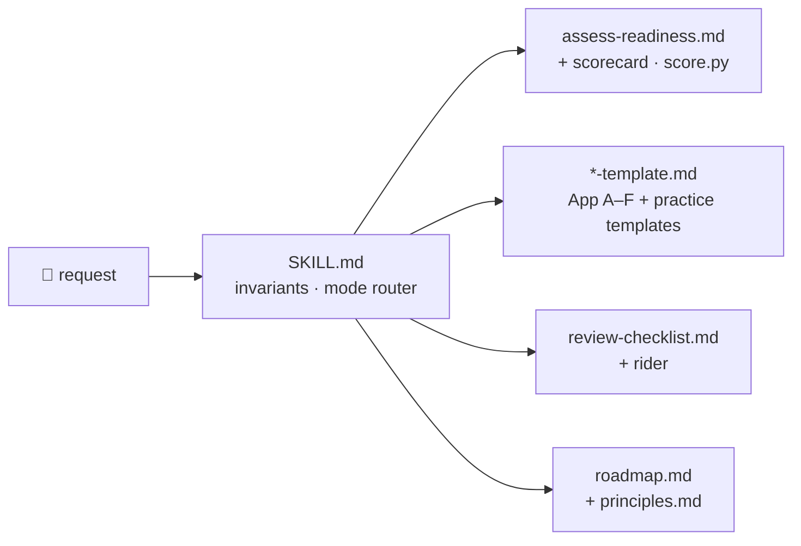

# 🧱 durable-layer — a Claude skill


[](LICENSE)

Applies the method of ***The Durable Layer — Making your organization AI-ready without rebuilding it for every new model*** (Kevin Guezennec) inside Claude: **invest in the durable layer, rent the replaceable one, and never let the replaceable layer hold the durable one.**

| Mode | What you get |
|---|---|
| 🔎 **Assess** | Tasks scored D1–D6, floors F1/F2, gates G1–G6 → readiness R1–R4 and oversight mode, with the calibration caveat |
| 📝 **Fill a template** | Frame Card, Two-Layer and Dependency Ledgers, Trust Dashboard, Procurement Rider, Swap Rehearsal Runbook, five-line policy, decision table, tool contract, golden set, decision page |
| ⚖️ **Review** | A plan, RFP, contract or architecture checked against 12 principles, 12 shortcut signs and 10 rider clauses |
| 🗺️ **Roadmap** | A 90-day plan, Ground → People → Plumbing, one artefact, owner and date per row |



## 🎧 Podcast

Audio overviews of the book's method, always attached to the [latest release](https://github.com/kevngzc/durable-layer-skill/releases/latest):

- 🇬🇧 *The Durable Layer for Enterprise AI*, 26 minutes: [download (m4a, 50 MB)](https://github.com/kevngzc/durable-layer-skill/releases/latest/download/The_Durable_Layer_podcast_EN.m4a)
- 🇫🇷 *La strate durable*, 17 minutes: [télécharger (m4a, 34 Mo)](https://github.com/kevngzc/durable-layer-skill/releases/latest/download/La_strate_durable_podcast_FR.m4a)

The book's Appendix H QR codes point at these `latest/download` links, so **every release must carry `The_Durable_Layer_podcast_EN.m4a`, `La_strate_durable_podcast_FR.m4a` and `durable-layer.skill` under exactly those names.**

## Install

**Claude Code**
```bash
git clone <this repo> ~/Developer/durable-layer-skill
ln -s ~/Developer/durable-layer-skill/durable-layer ~/.claude/skills/durable-layer
```
Edit through the real path (`~/Developer/durable-layer-skill/durable-layer/…`); Claude Code write-protects `~/.claude/**`.

**claude.ai / Claude Desktop** — download [`durable-layer.skill`](https://github.com/kevngzc/durable-layer-skill/releases/latest/download/durable-layer.skill) from the latest release (or build it with `scripts/package.sh` → `dist/durable-layer.skill`) and upload it under *Settings → Capabilities → Skills*.

## Layout

```
durable-layer/            the skill (only this folder is symlinked or zipped)
  SKILL.md                invariants, modes, output rules
  references/             principles, workflows, templates (App A–F), glossary, standards
  scripts/score.py        readiness scorer (stdlib)
  .source                 book commit the content was derived from
scripts/sync-check.py     book ↔ skill invariants (formula, bands, floors, gates, rider, runbook)
scripts/package.sh        claude.ai package
tests/test_score.py       Appendix B cases + floor, borderline and gate rules
evals/                    one prompt per mode, with what a good answer contains
```

## Keeping it in step with the book

```bash
python3 -m unittest tests/test_score.py
python3 scripts/sync-check.py ~/Documents/CODE/FUN/the-durable-layer
```

When the book's chapters or appendices change, re-read the changed parts, update `references/`, run both checks, and write the new book commit into `durable-layer/.source`. The skill condenses the book; the book stays the source of truth.

📜 © 2026 Kevin Guezennec — [CC BY-NC-ND 4.0](LICENSE), same terms as the book.
